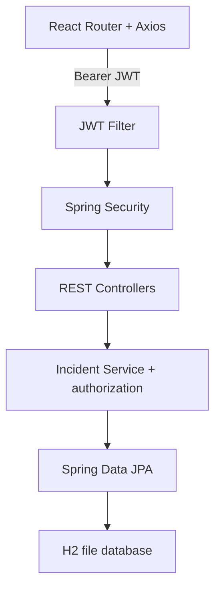
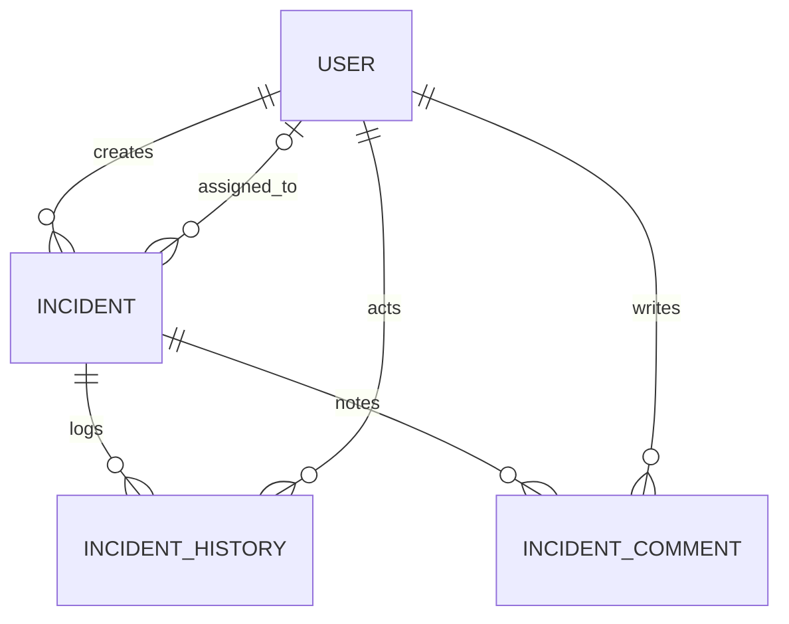

# IncidentGuard — Spring Security / JWT / React

Application pédagogique de déclaration et suivi des incidents informatiques, avec 3 rôles : EMPLOYEE, TECHNICIAN, ADMIN.

## Pré-requis
- JDK 17 ou supérieur
- Maven 3.9+ (commande `mvn`)
- Node.js 20+ / npm

## Exécution sous Windows PowerShell

Terminal 1 :
```powershell
cd backend
mvn spring-boot:run
```

Terminal 2 :
```powershell
cd frontend
npm install
npm run dev
```

Ouvrir http://localhost:5173. Backend : http://localhost:8080. H2 console de développement : http://localhost:8080/h2-console, JDBC URL `jdbc:h2:file:./data/incidents` (chemin relatif au dossier backend), user `sa`, mot de passe vide.

## Comptes de démonstration (local uniquement)
- ADMIN : `admin@demo.local` / `Demo12345!`
- TECHNICIAN : `tech@demo.local` / `Demo12345!`
- EMPLOYEE : à créer via l'écran d'inscription (faire deux inscriptions distinctes pour tester l'isolation des données).

Le compte ADMIN et le compte TECHNICIAN sont créés via `DevSeed` au premier lancement. Pour désactiver la création automatique des comptes de démo, positionner `DEMO_SEED=false` dans l'environnement. **Ne jamais déployer ces comptes de démo sur internet.**

## Routes
- Publiques : `POST /auth/register`, `POST /auth/login`
- Authentifiées : `GET/PUT /api/profile`, `PUT /api/profile/password`, `GET /api/incidents/{id}`, `GET /api/incidents/{id}/activity`
- EMPLOYEE : `POST /api/incidents`, `GET /api/incidents/my`
- TECHNICIAN : `GET /api/incidents/assigned`, `POST /api/incidents/{id}/notes`
- TECHNICIAN et ADMIN : `PUT /api/incidents/{id}/status`
- ADMIN : `GET /api/incidents`, `PUT /api/incidents/{id}/assign/{technicianId}`, `GET /api/admin/users`, `PUT /api/admin/users/{id}/enable`, `PUT /api/admin/users/{id}/disable`, `GET /api/admin/statistics`

Authenticated calls: `Authorization: Bearer <token>`. JWT expiry default: 5 min (`JWT_EXPIRATION_MS=300000`). Role comes from server-side account, never from self-registration.

## Sécurité
BCrypt, stateless JWT, JWT signature/expiry verification, account-enabled check on *every* request, backend resource ownership verification, `@PreAuthorize`, Bean Validation, central HTTP error responses, CORS restricted to localhost React.

Important: the default JWT key is for a **local class assignment only**; set a new random 32-byte Base64 key as `JWT_SECRET` before any use outside a local demo, use HTTPS, disable H2 console and demo seed, and configure production secrets and CORS. For production, prefer a supported Spring Boot line; this coursework example uses Spring Boot 3.5.16 for compatibility with commonly taught Spring Security configuration.

### Example: request JWT
```bash
curl -X POST http://localhost:8080/auth/login -H "Content-Type: application/json" -d '{"email":"admin@demo.local","password":"Demo12345!"}'
```

### Test scenario
1. Register employee A and employee B, login each.
2. Employee A creates 2 incidents; employee B creates 1.
3. Employee A requests B's incident ID; expect `403`.
4. ADMIN logs in, views all incidents, assigns one to TECHNICIAN.
5. TECHNICIAN views assigned incidents, changes status to IN_PROGRESS then RESOLVED, adds note.
6. Employee A sees updated status, history and notes.

### Mandatory Postman negative tests
1. `/api/profile` without JWT → 401.
2. Invalid signature token → 401.
3. Expired JWT → 401 (5-minute expiry).
4. EMPLOYEE requests `/api/admin/users` → 403.
5. EMPLOYEE accesses another employee's incident → 403.
6. TECHNICIAN updates an unassigned incident → 403.
7. Disabled account logs in → 401.
8. Duplicate email registration → 409 Conflict.
9. Blank title in incident creation → 400.

Capture Postman URL, method, token setup (mask sensitive token content), JSON response and HTTP status for the report.

## Architecture


## Entity relationship diagram


JPA uses `@ManyToOne` everywhere (the many side owns the foreign key). `EAGER` is used for the `User` references (incident author/assignee, history actor, note author) because every DTO and every ownership check reads their id/name, and the entities expose public fields: reading a field on an uninitialised LAZY Hibernate proxy returns `null`, which would break those checks. The `incident` back-reference in history/notes stays `LAZY` since it is never read. DTOs prevent entity serialization and leaking passwords. Bidirectional `@OneToMany` is not needed for the specified queries.

## Implementation status
Full coursework-oriented baseline source (backend + React). Frontend: `vite build` verified. Backend: reviewed statically only (Maven Central was unreachable in the review environment), so run `mvn spring-boot:run` locally and fix any compile issue before presenting it as completed. Optional refresh-token extension is NOT implemented.
